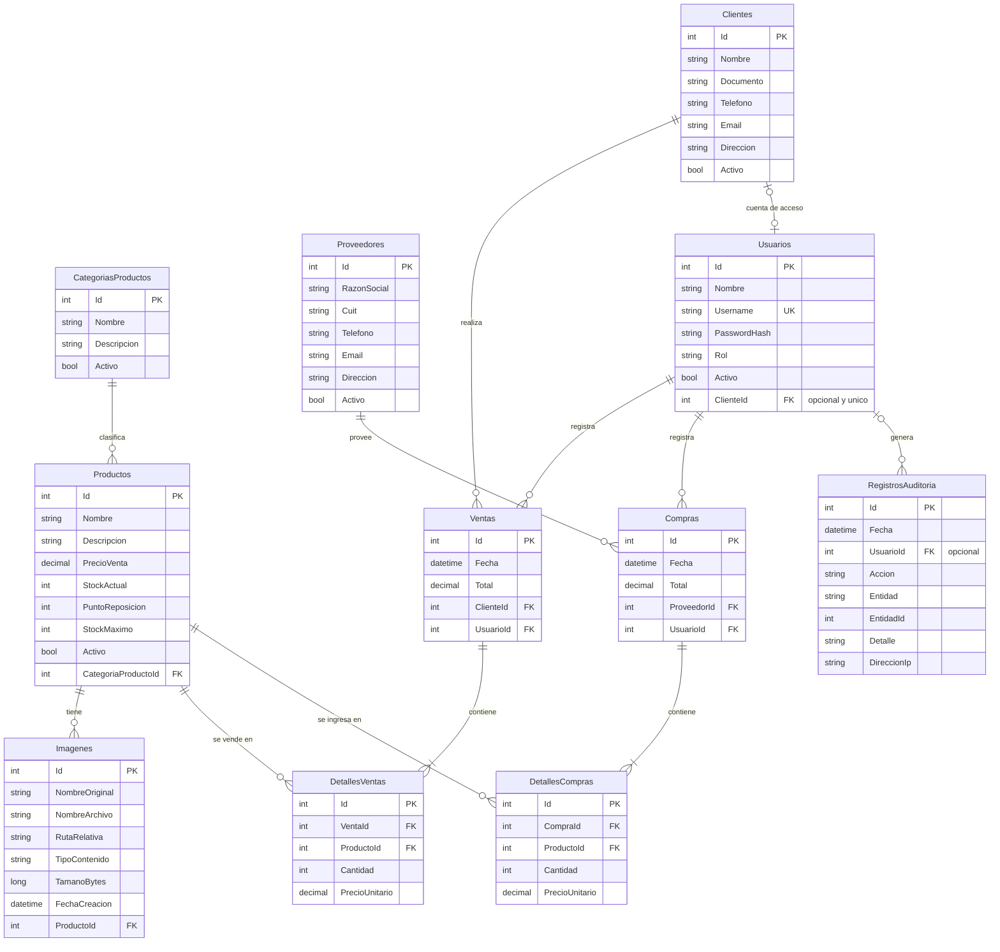

# Sistema de Ventas – Punto de Venta "Changomas"

Trabajo Práctico de Programación Web N° 3. Sistema de punto de venta para un negocio: registra ventas siempre con usuario autenticado, registra el ingreso de mercadería, mantiene el stock actualizado y genera reportes en PDF.

**Integrantes:** `[Nombre y apellido 1]` · `[Nombre y apellido 2]`
**Materia / Año:** `[Materia]` · `[Año]`

## Links para verificar el trabajo

| Qué | Link |
|---|---|
| Aplicación web (frontend, HTTPS) | https://TU-PROYECTO.pages.dev |
| API (backend, HTTPS) | https://tp3.runasp.net |
| Documentación interactiva de la API (Swagger) | https://tp3.runasp.net/swagger/index.html |
| Repositorio | https://github.com/TU-USUARIO/TU-REPOSITORIO |

Los usuarios de prueba (administrador y cajero) se entregan junto con el trabajo.

## Arquitectura

```
Navegador ──HTTPS──> Frontend: Blazor WebAssembly (Cloudflare Pages)
                          │
                          └──HTTPS + token JWT──> API: ASP.NET Core (.NET 10, MonsterASP.NET)
                                                        │
                                                        └──> SQL Server (base del hosting)
```

| Carpeta | Contenido |
|---|---|
| `SistemaVentasApi/` | Backend: API REST con Entity Framework Core, JWT, Serilog, QuestPDF y MailKit |
| `SistemaVentasWeb/` | Frontend: Blazor WebAssembly Standalone para escritorio |

## Requisitos de la consigna y dónde se cumplen

| Requisito | Cómo se cumple |
|---|---|
| Frontend Blazor WebAssembly Standalone | Proyecto `SistemaVentasWeb`, publicado como sitio estático |
| Punto de venta, ventas siempre con usuario autenticado | Pantalla `/pos`; `POST api/Ventas` exige token y toma el usuario del token |
| Entradas de mercadería y stock actualizado | Pantalla `/ingreso` (`POST api/Compras`) suma stock; `/stock` lo muestra en vivo |
| Reportes PDF de stock, entradas y salidas, y envío por correo | Pantalla `/reportes`; endpoints `api/Reportes/{stock,entradas,salidas}` y `api/Reportes/enviar` |
| Control de acceso y roles | Roles `Admin`, `Cajero` y `Cliente`; solo el administrador ingresa mercadería (ver tabla de permisos) |
| Auditoría y registro de errores verificable | Tabla `RegistrosAuditoria` (pantalla `/auditoria`, `GET api/Auditoria`) y archivos de log con Serilog |
| Repositorio Git, grupo de 2 | Este repositorio |
| Hosting gratuito con HTTPS | API en MonsterASP.NET y frontend en Cloudflare Pages, ambos con certificado SSL |
| Base de datos en 3FN | Ver sección "Modelo de datos" |

## Roles y permisos

| Acción | Sin sesión | Cliente | Cajero | Administrador |
|---|---|---|---|---|
| Ver catálogo (productos activos) | Sí | Sí | Sí | Sí |
| Registrar ventas | No | A su nombre | Sí | Sí |
| Ver ventas | No | Solo las suyas | Solo las que registró | Todas |
| Consultar clientes | No | No | Sí | Sí |
| Ingreso de mercadería | No | No | No | Sí |
| Proveedores, alta y edición de productos | No | No | No | Sí |
| Reportes PDF y envío por correo | No | No | No | Sí |
| Gestión de usuarios | No | No | No | Sí |
| Consultar auditoría y errores | No | No | No | Sí |

La aplicación web es para el personal del negocio: el login rechaza el rol `Cliente`. Los permisos los aplica la API con el token de cada usuario; los menús ocultos del frontend son solo comodidad visual.

## Modelo de datos



### Normalización (3FN)

- **1FN:** todas las columnas guardan valores atómicos, cada tabla tiene clave primaria y no hay grupos repetidos. Los ítems de una venta o compra no están dentro de la cabecera: van en `DetallesVentas` y `DetallesCompras`.
- **2FN:** todas las tablas tienen clave primaria simple (`Id`), por lo que ningún atributo puede depender de solo una parte de la clave.
- **3FN:** los datos de otras entidades no se repiten, se referencian por clave foránea. La categoría de un producto está en `CategoriasProductos`, los datos del proveedor en `Proveedores`, los del cliente en `Clientes` y los del usuario en `Usuarios`. Ninguna columna no clave depende de otra columna no clave.

Decisiones de diseño a tener en cuenta:

- `PrecioUnitario` se guarda en cada detalle a propósito: es el precio del momento de la operación y no debe cambiar si el producto cambia de precio después. No es una dependencia transitiva, es un dato histórico.
- `Total` en `Ventas` y `Compras` es un valor calculable a partir de los detalles. Se conserva como dato histórico de cada operación y para consultar sin recalcular.
- `Usuarios.ClienteId` es opcional y único: solo los usuarios con rol `Cliente` tienen ficha de cliente (la usa la futura app móvil).

## Seguridad

- Contraseñas guardadas con hash (ASP.NET Core Identity `PasswordHasher`), nunca en texto plano.
- Autenticación con token JWT firmado, con vencimiento de 2 horas.
- El usuario de cada venta e ingreso se toma del token, nunca del cuerpo de la petición.
- El descuento de stock es atómico y transaccional, para evitar vender de más con ventas simultáneas.
- Registro público: siempre crea usuarios con rol `Cliente`. Los usuarios `Cajero` y `Administrador` los crea un administrador.
- Claves y credenciales (JWT de producción, SMTP, cadena de conexión) fuera del repositorio.

## Auditoría y registro de errores

- **Tabla `RegistrosAuditoria`:** quién, qué, cuándo y desde qué IP. Registra inicios de sesión (correctos y fallidos), ventas, ingresos de mercadería, reportes generados y enviados, alta y baja de usuarios, cambios de contraseña y errores del sistema. Se consulta desde la pantalla **Auditoría** (solo administrador) o con `GET api/Auditoria`.
- **Archivos de log (Serilog):** carpeta `logs/` en el servidor, con `log-AAAAMMDD.txt` y `errores-AAAAMMDD.txt`.
- **Errores no controlados:** el servidor responde un error 500 con un identificador de seguimiento (`traceId`), y el detalle queda en el log y en la auditoría.

## Cómo ejecutarlo en local

Requisitos: .NET 10 SDK, SQL Server (por ejemplo SQL Server Express) y Visual Studio 2022 o superior.

1. Clonar el repositorio y abrir `SistemaVentasApi.slnx`.
2. Revisar la cadena de conexión en `SistemaVentasApi/appsettings.json` (por defecto `localhost\SQLEXPRESS`).
3. Crear la base de datos desde la carpeta `SistemaVentasApi/SistemaVentasApi`:
   ```
   dotnet ef database update
   ```
4. Para probar el envío de reportes por correo, cargar las credenciales SMTP propias (no se suben al repositorio):
   ```
   dotnet user-secrets set "Smtp:User" "tu_cuenta@gmail.com"
   dotnet user-secrets set "Smtp:Password" "contraseña-de-aplicación"
   ```
5. Iniciar los dos proyectos a la vez: clic derecho en la solución, "Configurar proyectos de inicio", "Varios proyectos".

## Tecnologías

ASP.NET Core Web API (.NET 10) · Entity Framework Core · SQL Server · JWT · Serilog · QuestPDF · MailKit · Blazor WebAssembly · Bootstrap
